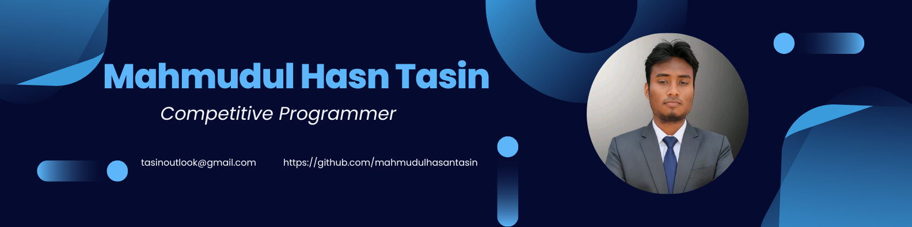

  

 

##  Hi 👋, I'm Mahmudul Hasan Tasin
- 🔭 **I’m currently working on:** Backend Systems, AI Agents, and Machine Learning pipelines
- 🌱 **I’m currently learning:** FastAPI, Advanced RAG architectures, and Model Context Protocol (MCP)
- 👯 **I’m looking to collaborate on:** Open-source AI projects, Backend Development, and Machine Learning
- 🤔 **I’m looking for help with:** Scalable system design and advanced optimization techniques
- 💬 **Ask me about:** Python, JavaScript, C++, Backend APIs, and Machine Learning basics
- ⚡ **Fun fact:** I love building intelligent systems and watching a trained model finally make accurate predictions 🤖

 

## 💼 Tech Stack

<h3 align="center">Languages & Frameworks:</h3>

  

<h3 align="center">Tools & Platforms:</h3>

  

<h3 align="center">Others:</h3>

  

 

## 🌐 Connect with Me

- LinkedIn: [Mahmudul Hasan Tasin](https://www.linkedin.com/in/mahmudul-hasan-tasin/)
- GitHub: [Mahmudul Hasan Tasin](https://github.com/mahmudulhasantasin)
- Email: [tasinoutlook@gmail.com](mailto:tasinoutlook@gmail.com)
